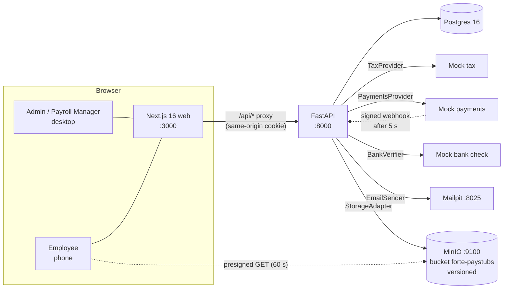
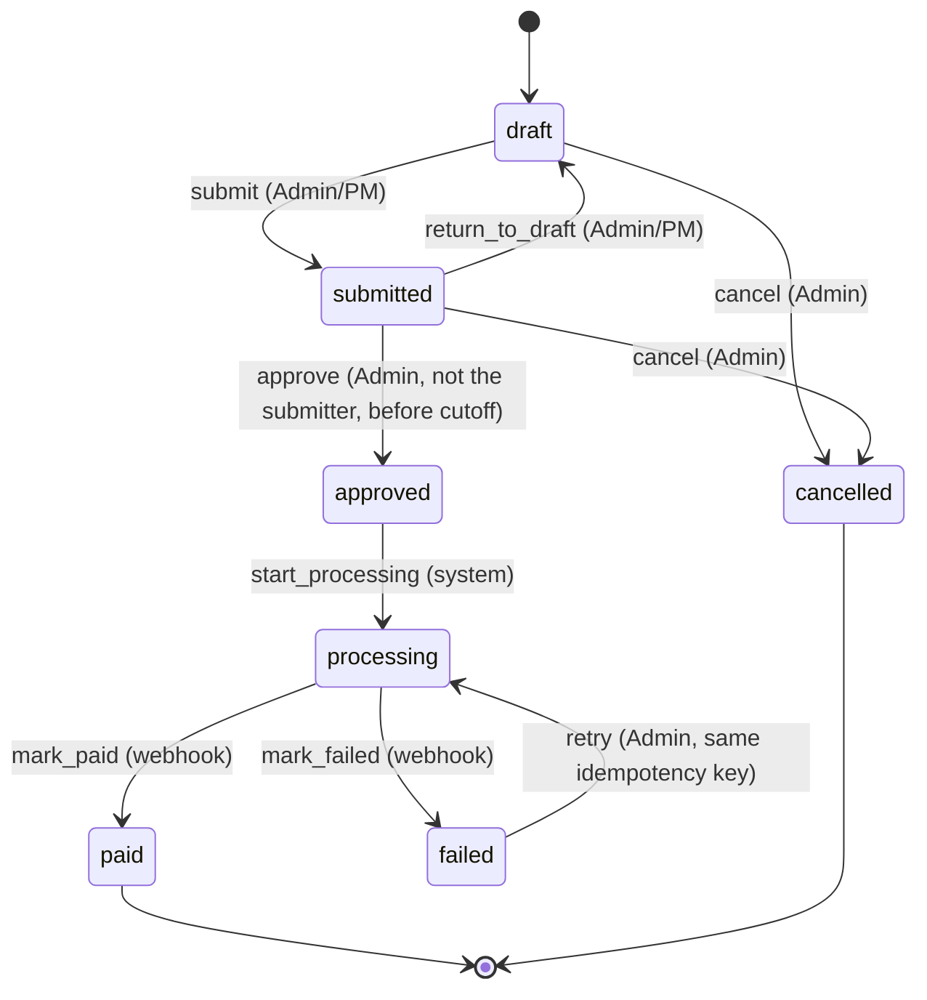
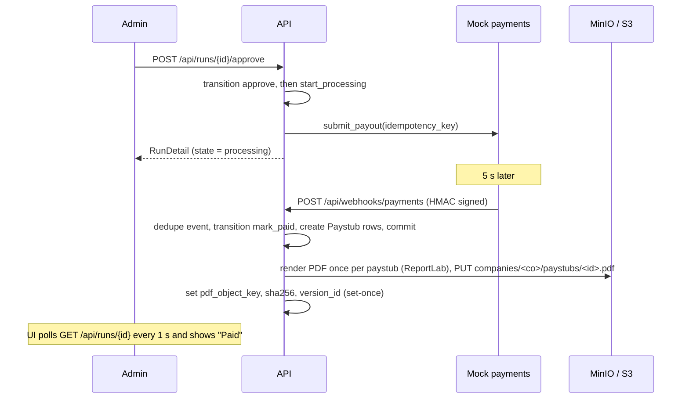

# Architecture

## System

The frontend never computes money and never sees full SSNs or account numbers. Every calculation,
state change, payout and file access goes through FastAPI. Each external system sits behind an
interface in `api/app/adapters/` with a mock; production swaps the implementation by config.

## Payroll run lifecycle (D7)

- The table in `api/app/payroll/states.py` is the single source of truth. `transition()` locks the
  run row (`SELECT … FOR UPDATE`), checks the table + guards, sets timestamps, writes the audit
  entry, and does not commit.
- Items are writable only in `draft` (DB trigger). Totals always equal the sum of items (NFR-2).
- Submitting a regular run locks the period's approved timesheets; returning to draft or
  cancelling unlocks them.

## Approve → paid → paystub PDF (D8, D16)

- If storage fails after PAID, the run stays PAID (money moved). `make paystub-pdfs` renders and
  stores any missing PDFs later. It never re-renders a PDF that exists.
- Download: `GET /api/me/paystubs/{item_id}/pdf` checks the caller is that employee (active or
  former) in that company, then returns a 60 s presigned URL signed for `FORTE_S3_PUBLIC_ENDPOINT`.
  `GET …/pdf/file` streams the bytes through the API as a fallback.

## Pay periods and cutoff (D23)

Biweekly. For pay date P (a Friday in the demo): end = P − 5 days, start = end − 13 days,
cutoff = P minus `cutoff_lead_days` business days at 17:00 America/Los_Angeles, stored as UTC.
Example: pay Fri Dec 11 → period Nov 23–Dec 6 → approve by Wed Dec 9, 5:00 PM Pacific.

## Countdown (RUN-6, D28)

The API returns `cutoff_at` and `server_time`. The client computes the offset once, then ticks
locally every second. States: more than 24 h neutral; 24 h or less "Approve today"; 2 h or less
uses `--alert`; past cutoff and not approved: "At risk of a late paycheck" (`--alert`).

## API conventions

- Paths start with `/api`. Routers live one-per-area in `api/app/routers/`, all registered in
  `main.py`. Request/response models are in `api/app/schemas/` (this is the contract).
- Money fields end in `_cents` (int); hours in `_minutes` (int); masked numbers in `_last4`.
- Errors: `{"detail": {"code": "past_cutoff", "message": "Plain sentence for the user."}}` via
  `app.errors` (`NotFound`, `Forbidden`, `Conflict`, `Unauthorized`, `AppError`). 401 not signed
  in; 403 role; 404 missing or other tenant (same response); 409 rule/state conflict; 422 validation.
- Roles: `require_admin`, `require_staff` (Admin + PM), `require_employee_self(allow_former=…)`.
- Unbuilt endpoints return 501 with `task`.

## Web conventions

- Next.js 16 App Router (`web/AGENTS.md`: this version differs from older docs; read
  `node_modules/next/dist/docs/` for anything unfamiliar). Middleware is now `src/proxy.ts`.
- Route groups: `(public)` (login, verify, setup, dev), `(staff)` desktop shell, `(employee)`
  phone-first shell. Every page exists; placeholders name their task and design screen.
- Data: `"use client"` components with `$api.useQuery` / `$api.useMutation` from
  `@/lib/api/client`. After changing API schemas run `make gen`.
- Money: `formatCents`, `parseDollarsToCents`; hours: `formatHours`, `parseHoursToMinutes`.
- `useSearchParams()` must be inside `<Suspense>`; read dynamic params with `useParams()`.
- Styling: Tailwind v4 with Forte tokens (`bg-paper`, `text-ink-muted`, `font-display`,
  `text-title`, `eyebrow`, `num`, `tile-gradient`). Match `docs/design/screens/*.dc.html`.
- Accessibility (NFR-12): real `<button>`/`<a>`/`<label>`, visible focus (global ring), 4.5:1
  text contrast, 44 px touch targets on employee screens, works at 375 px wide (NFR-11).

## Data model

See `api/app/models/` (one class per table, docstrings explain rules). Highlights: every tenant
table has `company_id`; compensation and withholding are append-only with `effective_date`;
bank accounts are replaced, never edited; `audit_log` is insert-only (trigger); payroll items
are locked outside draft (trigger); paystub PDFs are set-once (trigger).

## Testing

- `api/tests/conftest.py`: real Postgres, one rolled-back transaction per test, `as_actor(member)`
  to act as someone, in-memory storage and email. Factories in `tests/factories.py`.
- Required per task: happy path, each guard/permission failure, and cross-tenant 404 for any
  endpoint that takes an id. State machine: every legal transition and every illegal one.
- CI runs `make check` on every PR (lint, tests, generated files up to date).

## Deployment

The demo runs locally (D4). This is how Forte deploys to production. Nothing in the app changes,
only configuration:

| Piece | Production | Config |
|---|---|---|
| Web | Vercel (Next.js), or the `web` Docker image on any container host | `FORTE_API_URL` = API's internal URL |
| API | `api/Dockerfile` on Render / Fly.io / AWS App Runner. Runs `alembic upgrade head` on start | all `FORTE_*` vars from the host's secret store |
| Database | Managed Postgres 16 (Render, Neon, or RDS) with daily backups | `FORTE_DATABASE_URL` |
| Object storage | AWS S3 bucket `forte-paystubs`: versioning on, Block Public Access on, SSE-S3 encryption, lifecycle rule keeping noncurrent versions ≥ 4 years (optionally S3 Object Lock in compliance mode for 4-year retention) | `FORTE_STORAGE_BACKEND=s3`, `FORTE_S3_ENDPOINT=` (empty = AWS), `FORTE_S3_PUBLIC_ENDPOINT=` (empty), IAM keys or role scoped to that bucket |
| Email | Transactional provider (e.g. Resend/SES) behind `EmailSender` | provider key |
| Tax / payments / bank | An embedded-payroll vendor (tax calc + payouts + webhooks) and Plaid-style bank verification, each a new adapter class | vendor keys, `FORTE_PAYMENTS_WEBHOOK_SECRET` |
| Secrets | Host secret manager; `FORTE_ENCRYPTION_KEY` rotated via re-encryption job | config refuses dev defaults when `FORTE_ENV=prod` |
| CI/CD | GitHub Actions: `make check` on PRs; on merge to `main`, build images and deploy; migrations run once on release | — |

Local stack for the demo: `make up && make api && make web`, or everything in containers with
`docker compose --profile app up --build`.
